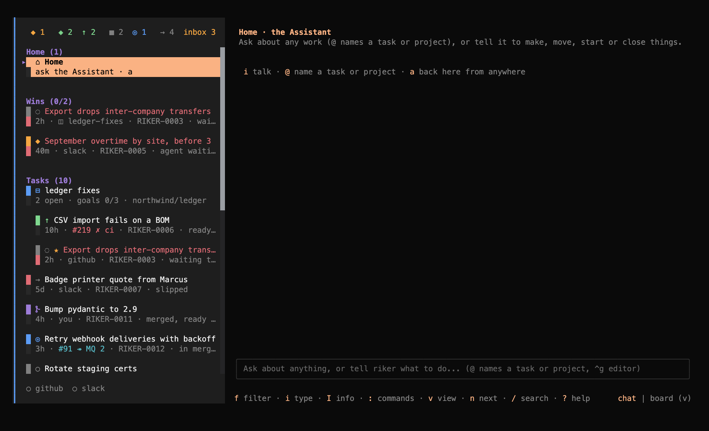
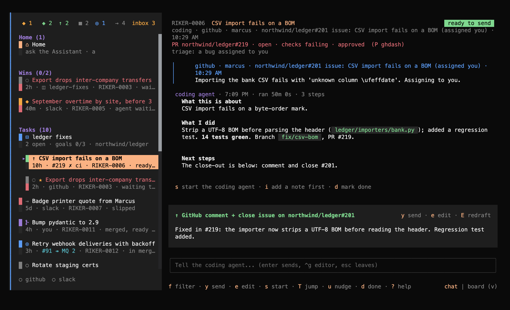
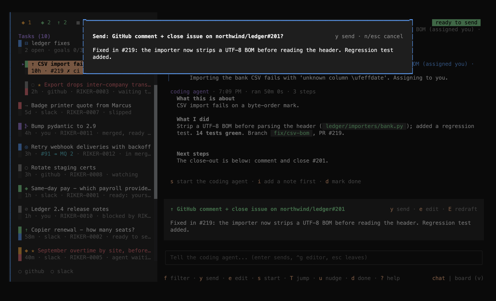
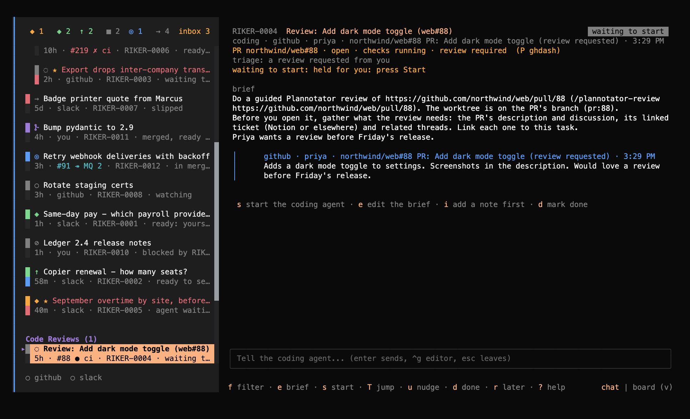
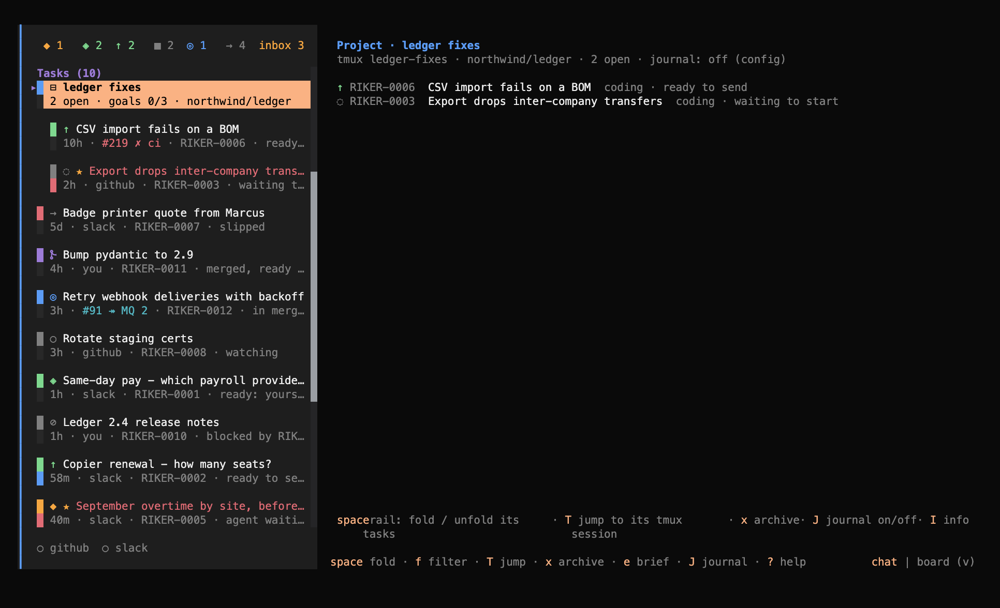
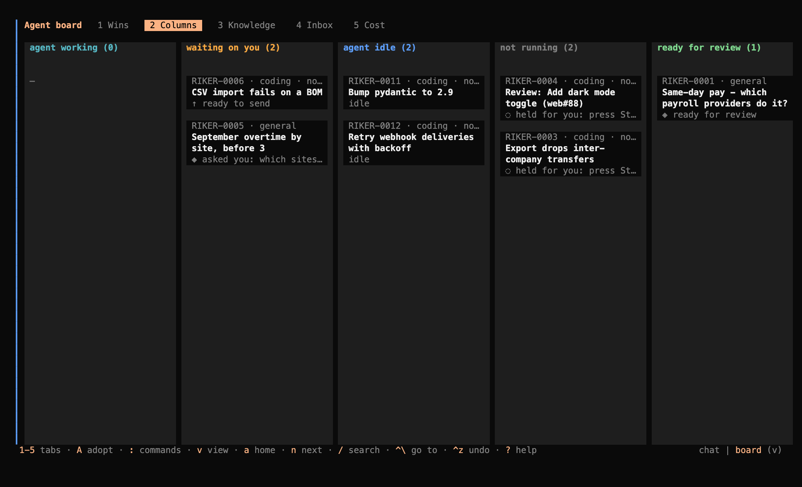
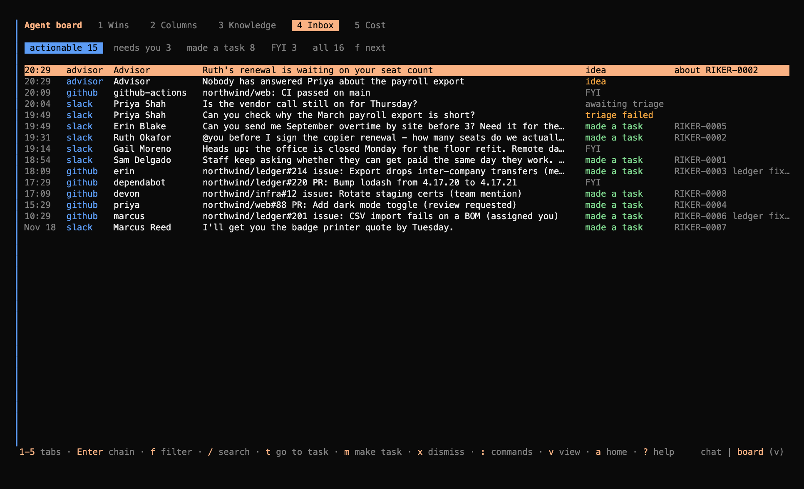

# Riker

Your work manager in a terminal. GitHub and Slack become tasks, Claude does the
work, and nothing goes out until you approve it.

## Try it

```sh
bun install
bun run demo        # a fictional morning: no network, no AI, nothing sends
```

The demo runs the real interface on seeded GitHub and Slack work. The brain
answers from canned lines, Send says it is the demo, and a coding agent is a
small fake that fires the same hooks real Claude Code does. Each run starts from
a fresh scratch home.

## What it looks like

All of these are the demo's fictional morning (`bun run demo`).



**Home.** The rail on the left is everything waiting on you, grouped by what it
needs; Home is the Assistant, which you can ask about any work or tell to make,
move, start or close things.



**A task.** The selected row opens on the Canvas: where it came from, its PR's
checks and reviews, what the coding agent did, and the reply Riker drafted.



**Nothing goes out until you approve it.** `y` shows the exact words and where
they go; `n` or `esc` cancels.



**A review request.** A PR that asks for your review becomes a coding task whose
brief is a guided Plannotator review, held until you press Start.



**A project.** Tasks on one repo sit under their project, which carries a brief,
goals and its own tmux session for the agents.



**The Board.** `v` switches to the Board; Columns sorts every task by what its
agent is doing.



**The Inbox.** Every message triage saw, newest first, with what it became: a
task, an FYI, or held for you.

## Run it for real

Requirements: [bun](https://bun.sh), the [`claude`](https://docs.claude.com/en/docs/claude-code) CLI (logged in),
[`gh`](https://cli.github.com/) (logged in), [tmux](https://github.com/tmux/tmux)
3.3a or newer (3.7 for live updates), and [worktrunk](https://worktrunk.dev) (`wt`) for coding tasks.

```sh
export SLACK_TOKEN=xoxp-...   # optional: a Slack *user* token
bun dev                       # or: bun packages/cli/script/riker.ts
```

- **GitHub** uses your `gh` login. The inbox is your participating
  notifications: review requests, mentions, assignments, and comments on threads
  you are part of. Riker never marks a notification read.
- **Slack** has three transports, set with `slack.transport`:
  - **`token`** (default) uses a Slack _user_ token in `SLACK_TOKEN`, so
    replies go back as you. Scopes:
    `im:read mpim:read im:history mpim:history channels:history groups:history users:read chat:write`,
    plus `search:read` for mentions outside DMs.
  - **`claude-mcp`** is for when you have no token. Riker runs a long-lived
    `claude -p` with a Slack MCP, such as the Slack connector added on
    claude.ai, and asks it each poll for new messages as JSON.
    - That reading session gets the Slack _read_ tools only. Every write tool is
      denied, so text inside a message has nothing to post with.
    - Each Send is a separate one-shot call whose only tool is the send tool
      and whose only input is your approved words.
    - Every poll is a model turn (haiku by default, `slack.model`; once `brain.slackModel`), so it
      polls every 180s unless you set `slack.pollSeconds`.
    - `slack.mcpServer` picks the server when its name doesn't say "slack".
  - **`mcp`** (Riker as a direct MCP client to a local Slack MCP server) is
    reserved and not built. Selecting it says so in the status line.

State lives in `~/.riker` (`RIKER_HOME` overrides): `riker.db` (SQLite), `config.json`,
`docs/`, and each general agent's scratch folder under `work/`.

`docs/` holds the brain docs, seeded from this repo's `packages/core/defaults/`:

- **Yours** (`PERSONA.md`: red lines and how Riker speaks to you; `JOB.md`;
  `STYLE.md`): templates. A short interview with the Assistant drafts them
  (offered once as a System task; ask the Assistant to onboard you any time).
- **Shipped** (`TRIAGE.md`, `ASSISTANT.md`, `CODING.md`): updated with Riker
  while you leave them alone. Once you edit one, Riker never writes it again; a
  new shipped version becomes a System task (`e` diff in revdiff, `y` take it,
  `x` keep yours).
- **`LEARNED.md`** writes itself (see below). Lessons that leave it go to
  `LEARNED.archive.md`, which no prompt reads.

Nothing is merged and there is no history: before Riker writes over a doc, the
old file is copied to `docs/.trash/` (kept 30 days). Each doc has a character
budget (`shift+d` shows sizes; `docBudgets` in config overrides). Over it,
the Advisor proposes a shorter one; past twice it, prompts cut it with a note.
`docs/examples/` holds filled-in ones to copy from.

### Config

`~/.riker/config.json`. Every key is optional. `github`, `slack` and
`remote` belong to their plugins (`@riker/github`, `@riker/slack`), which
read their own defaults under what you write:

```json
{
  "repos": { "northwind/ledger": "/Users/me/src/ledger" },
  "github": {
    "pollSeconds": 120,
    "mergeMethod": "squash"
  },
  "slack": {
    "transport": "token",
    "pollSeconds": 60,
    "channels": ["C0123ABC"],
    "model": "haiku"
  },
  "brain": {
    "triageModel": "haiku",
    "agentModel": "sonnet",
    "assistantModel": "sonnet"
  },
  "opener": "open",
  "maxActiveAgents": 4,
  "spend": { "capEnabled": true, "dailyUsd": 25 },
  "chat": { "idleMinutes": 55, "homeMaxTokens": 60000 },
  "worktreeCommand": "wt -C {repo_path} switch {create} {branch} --no-cd --format json -y",
  "autostart": true,
  "learning": true,
  "triage": {
    "escalate": {
      "github": ["assign", "mention", "review_requested"],
      "slack": ["dm", "mention"]
    },
    "reviewTeams": ["northwind/payments"]
  },
  "theme": "default",
  "log": { "enabled": false, "level": "info" },
  "capabilities": {
    "grants": { "general": ["slack.read", "docs.read", "notion.read"], "assistant": ["slack.read", "notion.read"] }
  }
}
```

`repos` maps a repository to its local checkout (a file from before it
moved is read from `github.repos`); a coding task gets a
worktree of it (Riker asks for the path the first time a repo is unmapped).
A pull request that requests a review of you, or of a team in
`triage.reviewTeams` (`org/team-slug`, or a bare slug for any org; once
`github.reviewTeams`), or tags
you or one of those teams in a comment, always becomes a coding task on the
PR's branch (`pr:N`) whose brief is a guided Plannotator review; other review
asks the triage model finds are coding tasks too.
`worktreeCommand` makes that worktree: `{repo_path}`, `{create}` (`-c` for a new
branch) and `{branch}` are filled in, and it must print wt's JSON or a path on
its last line. Swap in your own alias, or add `--no-hooks`. `tmuxSocket` puts
agents on a private tmux server (`-L`); unset means your default one. `slack.channels` are channels where every message is triaged.
Anywhere else, only DMs and mentions of you are triaged. `opener` opens links
and files the agent made: a command or an argv array, with the target appended.
It defaults to `open` on macOS, `wslview` on WSL and `xdg-open` on Linux.

`spend` caps what Riker's own model calls cost in a day (triage, the
Assistant, general agents, the Advisor, the Slack reader; coding agents in
tmux are not counted). Once today's total reaches `dailyUsd`, chat turns Riker
starts by itself wait with the reason on the task and the Advisor skips its
run; a turn you start or type to still runs. `capEnabled: false` turns the cap
off; spend is recorded either way. The sidebar's status line shows today's
total, the Board's Cost tab (`6`) and `riker-tools spend` break it down by role,
task and day.

`chat` bounds the sessions chat turns resume. The prompt cache lasts an hour,
so a turn whose session last answered more than `idleMinutes` ago starts a new
one that reads the conversation back, rather than paying to re-write the whole
old one. Home also starts over once its context passes `homeMaxTokens`. `0`
turns either off.

`triage.escalate` says what else may become a task without you. On GitHub
that is the notification reasons listed (by default: assigned to you, a
mention of you, a review requested of you). A review requested only of a
team, or an `@org/team` tag, counts only for a team in `triage.reviewTeams`.
On Slack it is a DM to you or a message that mentions you. Anything else the model calls work is
held in the Inbox as "needs you", and `m` there makes the task its verdict
describes.

### Talk to the Assistant from Slack

Write to Riker from your phone, or from any Slack client: your messages in one
Slack conversation go to Home as if you typed them there, and the Assistant
answers in the message's thread. It is off until you turn it on, and it is
separate from the Slack inbox (`slack.enabled` can stay off).

1. **Pick the conversation.** It must have only you in it. Either one works:
   - your self-DM (the DM with yourself), or
   - a private channel you make and leave with one member. It is easier to
     find on a phone, and it keeps Riker apart from your notes to self.

   Riker checks the members on every read. If anyone joins, or the channel is
   public, it hears nothing and the status line says why.
2. **Get its id.** In Slack, right-click the conversation in the sidebar,
   then *Copy link*. The id is the last part of the link (`D…` for the
   self-DM, `C…` for a channel). With a token you can skip this for the
   self-DM, because Riker finds it.
3. **Make sure Riker can reach Slack** the way `slack.transport` says:
   - `claude-mcp`: the Slack connector on claude.ai works in `claude`. The
     id from step 2 is required. Each read is a short model turn, so Riker
     checks every 60s.
   - `token`: `SLACK_TOKEN` also needs `im:write` (to find the self-DM) and
     `groups:read` (for a private channel). Riker checks every 15s.
4. **Turn it on** in `~/.riker/config.json`, then restart riker:

   ```json
   {
     "remote": {
       "enabled": true,
       "channel": "D0123ABCD",
       "notify": ["finished", "waiting"]
     }
   }
   ```

   `notify` is optional. `finished` posts when a coding agent's work is ready
   or an agent closed its task. `waiting` posts when an agent waits on you,
   with its question. A reply under a notification is about that task.
   `pollSeconds` overrides how often Riker checks.
5. **Check it:** `remote` shows on the connector line, and in `C`
   (connections). Write "what is running?" in the conversation. The answer
   comes back in its thread within a check or two, starting with `[riker]`.

What to expect:

- The Assistant has the same tools and limits as in Home, and it never
  sends anything to anyone. Its answers are short, and a long one is cut,
  with the rest in Home.
- `start`, `stop`, `done`, `ignore` and `project_archive` wait for you.
  The answer ends with "Reply *yes* in this thread to …". `yes` runs it,
  `no` leaves it, and anything else drops it and goes to the Assistant. The
  request lapses after 10 minutes.
- Riker hears only messages written after it was turned on, only your own,
  and never bots or its own `[riker]` answers. Message text is never logged.
- When Slack is unreachable, nothing is lost: answers wait and go out on a
  later check.
- To turn it off, set `"enabled": false`. That takes effect on the next
  check.

The design and its limits are in [`docs/slack-remote.md`](docs/slack-remote.md).

### Capabilities

Agents and the Home assistant get no connector tools unless you grant them.
`capabilities.grants` lists, per role (`general` for agents, `assistant` for
Home), the capabilities that role may use:

- `slack.read`: read and search Slack through the claude.ai Slack connector
  (threads, channels, canvases, files, lists, profiles, search)
- `docs.read`: read, export and query Claude Docs (`read`, `query`,
  `export`, `guide`)
- `docs.write`: make and edit Claude Docs (`batch`, `create`, `update`, plus
  the reads above). Off unless you grant it. `delete` is left out; to allow
  it, list it in `capabilities.tools["docs.write"]` with the other tools.
- `notion.read`: fetch and search Notion pages and read their comments, through
  the claude.ai Notion connector

So to let task agents make docs (an artifact linked to the task) and the
Assistant read them:

```json
"capabilities": {
  "grants": { "general": ["docs.write"], "assistant": ["docs.read"] }
}
```

The change applies on the next turn, no restart. With `docs.write`, an agent
makes the doc's skeleton first, fills its sections, and the doc is linked to
the task by itself (the Assistant links one with `move link`). A doc's
contents stay in the doc and the task's thread.

Sessions run with `--permission-mode dontAsk`, so any tool that isn't granted is
denied without a prompt. A denied connector call shows under the turn with the
grant that would allow it (`to allow mcp__claude_ai_Claude_Docs__batch: add
"docs.write" to capabilities.grants.general in ~/.riker/config.json`), and every
agent is told where grants live, so asking it how to enable one gets this
answer. `docs.write` is the only write capability: there is none for sending,
drafting, scheduling, reacting, or creating, editing or moving Slack or Notion
pages. A send is only ever your press. `capabilities.servers` (capability to MCP server name, e.g. `"slack.read": "slack"`) and
`capabilities.tools` (capability to bare tool names) override the built-in
mapping, for example to point at a different Slack server. These overrides
still fail closed: an unknown capability grants nothing, and a tool name that
looks like a write (send, post, update, delete, add, …) or isn't a plain name
(a glob, say) is dropped with a warning in the log. The one exception is
`docs.write`'s own Docs writes, and only on the Claude Docs connector: an
override can narrow them or add `delete`, never add another write. The mapping
lives in `packages/core/src/capabilities.ts`.

### Task actions

An action is a skill Riker runs on one task, at your word: `.` on a row picks
one, the palette lists them, and `riker-tools move action AUG-0012 summarize`
runs one (the Assistant can too; from Slack it waits for your yes). Its
answer is an entry of its own on the task, never the agent's. Three ship
with Riker, as skills in Riker's own plugin (written under `~/.riker/plugin`, so
nothing to install):

- `summarize`: the work so far (goal, done, decisions, left, blocked), on a
  copy of the agent's session, so the agent is not disturbed.
- `guide` (coding, with a checkout or a repo to make one): a guided review
  of the branch in chapters, with review findings, saved into Plannotator
  and opened in
  `plannotator review` with each finding as a comment on its lines (from
  "Riker guide"). The comments you keep, and yours, go to the agent when you
  send feedback. Needs `plannotator` on your PATH. The findings are kept
  with the guide, so **Open the guide's review** (in `.` and the palette,
  once a task has a guide) opens that review again with no model run, each
  finding refit to the change as it is now. The change is taken against
  `origin/main` when it is ahead of your `main`; lock files are left out,
  and a big change is reviewed in batches of related files (same commit,
  a test and its code, one naming what another defines), so every file's
  diff is read. A review that just arrived offers it before any agent
  starts (its task says so): running it makes the `pr:N` worktree first
  (asking where the repo is when it is unmapped, as Start does), with no
  agent. Its review opens on the pull request itself (`plannotator review
  <PR URL>`, with the findings as comments), and Plannotator's Post to
  GitHub sends your review there (approve, comment or request changes, on
  the lines); nothing goes to the agent. Your own work's review opens on
  its worktree, and what you send goes to its agent, never GitHub. A
  branch that does not exist yet has nothing to review: start the agent
  first.
- `quiz` (coding, with a checkout): quizzes you on the change, one question
  at a time, in interactive claude beside the agent (or on the Canvas when
  it has no window).

`actions` in config changes one field by field, turns one off, or adds one:

```json
"actions": {
  "summarize": { "model": "haiku", "key": "shift+u" },
  "quiz": { "skill": "quiz-me", "args": "10 questions" },
  "guide": false,
  "recap": { "skill": "recap", "via": "headless", "title": "Recap for standup" }
}
```

| field        | meaning                                                                                          |
| ------------ | ------------------------------------------------------------------------------------------------ |
| `skill`      | `plugin:name` (Riker's own are `riker:summarize`, `riker:guide`, `riker:quiz`) or a skill of yours in `~/.claude/skills` |
| `args`       | text after the skill, with `{ref}` `{title}` `{worktree}` `{branch}` `{base}` `{pr}` filled in |
| `via`        | `fork` (a copy of the agent's session; headless when it has none), `headless`, `agent` (typed to the agent) or `pane` (interactive, beside the agent) |
| `output`     | `turn`, `file` (also under What it made), `none`, or `guide`                                     |
| `kinds`, `needs` | the rows it applies to: kinds of task, and `worktree`, `session` or `pr`                     |
| `capability` | a capability loaded for this run only, e.g. a plugin that holds the skill                       |
| `key`        | a key of its own on the rail and the Canvas, read at start and listed in the footer on rows it applies to; one Riker already uses is refused |
| `model`, `title` | the model (default `brain.agentModel`) and the picker's label                                |
| `on`         | events that run it by itself, once per task (below)                                             |

`on` lists events, each with plain rules that must all match: `triaged`
(triage made a task or added a message to one), `ready` (the agent said its
work is done), `merged`, `done`; rules `kind`, `channel`, `githubReason`,
`author`, `title`, `body` (case-blind regexes, as in `triage.noise`) and
`project`. Runs it starts wait for each other, stop at the day's spend cap,
and never open anything: a guide is saved for you to open with **Open the
guide's review**, and its turn says so. Nor do they make a worktree: a
review that just arrived has none, so its guide waits for you.

```json
"guide": { "on": [{ "event": "ready" }] },
"summarize": { "on": [{ "event": "ready" }] }
```

A skill of yours runs headless only if its `allowed-tools` stay within
read-only tools and what its `capability` grants; otherwise the run is
refused with the tools it asked for. In a pane, interactive claude loads
your skills as usual. Changes apply on the next run, keys on the next start.
The design is [`docs/task-actions-design.md`](docs/task-actions-design.md).

### Logging

Riker can write a file log to `~/.riker/riker.log`: connector status changes (Slack,
GitHub, the Advisor), errors, a trace of every model call, agent turns, sends,
and timings for polls and calls. It is off unless one of these turns it on,
first match wins:

- `RIKER_LOG=trace|debug|info|warn|error` (or `on`, which means debug, or `off`)
- `"log": { "enabled": true, "level": "info" }` in config (`log.file` and
  `log.maxBytes` are optional)
- dev mode: `bun run dev` sets `RIKER_DEV=1`, which logs at debug

The file rolls over to `riker.log.1` at 10 MB. Read it live with
`tail -f ~/.riker/riker.log`.

## How it works

The loop: something arrives, triage gives it a verdict, the verdict decides who
does the work, and whatever comes out waits for you.

- **Triage** runs gates first: dedupe, your own message, greetings, bots and CI
  noise, and threading (a GitHub issue or Slack thread attaches to its open
  task). Then one `claude -p --json-schema` call reads `TRIAGE.md`, `PERSONA.md`,
  `JOB.md` and `LEARNED.md` and returns `fyi`, `reply`, `general`, `coding`,
  `task` or `watch`. Work becomes a task on its own only when
  `triage.escalate` names the message (see [Config](#config)); other work is
  held in the Inbox for you. If triage fails, the message is filed as FYI. It
  is never assumed to be work.
- **A general or reply task is one chat.** Each agent turn is a headless
  `claude -p` call, resumed by session id. Its tool steps stream onto the turn
  live. It answers in three sections (_What this is about_, _What I did_,
  _Next steps_), and when a reply is owed it sets one up for you to send. Its
  tools are read-only look-ups plus writes in its own scratch folder; anything
  else is denied without asking. Files it writes there show under **What it
  made**: markdown rendered, CSV/TSV as a small table, anything else listed.
- **A coding task runs interactive Claude Code in tmux**, in its own worktree,
  in a window of its project's session (see [Projects](#projects)). The Canvas
  embeds a view of that window. Hooks passed with `--settings`
  (`riker-tools hook ...`) move it through the agent states. Its brief tells it
  to finish with `riker-tools done`, leave handoff notes, use Knowledge, link the
  PR it opens (`riker-tools pr`) and read what came back (`riker-tools feedback`).
- **Nothing sends itself.** A draft (a Slack reply, or a GitHub comment with
  merge, close or approve riding along) goes out only on `y` plus a confirm.
  Sending never closes a task. Mark done (`d`) does.
- **Correcting it teaches it.** A changed kind or priority, an edited draft
  and a redraft are each recorded. _Ignore_ (`x`) is not: it drops the task
  (done, if an agent worked on it) and files its messages as FYI, and says
  on the task who did it. ctrl+z takes it back, and `d` on a done or dropped
  task (from go-to or the Board's Wins) reopens it without starting its
  agent. A small model call turns each
  one into a line in `LEARNED.md`. New lines start at strength 2 under
  _Watching_, where nothing reads them, and move into use at strength 3. A
  _Watching_ line not seen again in 30 days goes to the archive.
- **The docs evolve by proposal.** Once a day the Advisor reads what went into
  use and what you corrected, and may propose an edit to `PERSONA.md`,
  `JOB.md` or `STYLE.md` (or a shorter `LEARNED.md`) as a System task. Notes
  you leave in revdiff, or type on the task, redraft it; `y` writes it and
  archives the lessons it absorbed. A lesson about how Riker itself should work
  becomes an Advisor idea instead.
- **The Advisor** reads your open work every few hours and leaves at most three
  ideas on the rail. It also marks a thread _slipped_ when it has waited on
  someone for too long.
- **Home is the Assistant**, first on the rail; `a` jumps there from anywhere.
  It is one long chat about all your work: `@` names a task or a project (it
  offers matches as you type), and the Assistant reads it before answering. It runs Riker for
  you through `riker-tools`: it looks up tasks and projects, makes tasks
  (`move new`, a coding task in a named project with a brief), moves them,
  starts and stops agents, and archives projects after you confirm. It never
  sends.
- **Moves go through the engine.** `riker-tools move <verb>` writes the move to
  the `moves` table and waits. The running Riker makes it and prints one line
  back, or why it could not ("no project X; projects: ..."). A task's own agent
  may make tasks (`--from` its task, which then hears about it) and edit its
  own task; starting, stopping and closing stay yours and the Assistant's.

## Projects

A project is one tmux session; each coding task in it is one window, one
worktree and one claude. tmux owns the claudes, so they outlive Riker and you can
work with them from any tmux client.

- **Make or adopt.** Board tab `5` makes a project (`c`) or adopts a session you
  already have (`A`). Riker tags the session with `@riker_project` and each window
  with `@riker_task`; names are only names, so rename freely. A coding task
  started outside a project gets a project of its own.
- **Start.** `s` asks for the branch (a new one, an existing one, or `pr:N`),
  runs `worktreeCommand`, and opens the window. Esc on the checkout question
  works in a scratch folder instead.
- **Watch and jump.** The Canvas shows the window through a grouped tmux session
  of Riker's own, so it never moves your real client. `T` moves your real client
  there; on the Board, `enter` on a project jumps to its session.
- **Finish.** `S` closes the window and keeps the worktree, so `s` resumes the
  same claude. `d` closes the window and runs `wt remove`; a dirty worktree is
  kept and Riker says so. A project made for one task is archived when that task
  is done. `x` on the Board archives a project; `M` moves a task (its window
  moves with it).
- **Brief, goals and docs.** `e` on a project (rail or Board tab `4`) opens
  one Markdown file in `$EDITOR`: the brief (what the project is for), its
  goals as a checklist (`[x]` met, `[-]` dropped; a line without a `G3` ref is
  a new goal) and its docs (a Notion page, a spec: one URL a line). Every
  task in the project reads all three in its agent's brief. A task names the
  goal it works toward (`move new --goal G3`, `move goal AUG-0012 G3`), and
  the Board shows each goal with its tasks and how many are done; a goal is
  met when you say so. The Assistant writes them too (`move project_brief`,
  `goal_new`, `goal_set`, `project_link`), and `riker-tools project <name>`
  prints the whole project.
- **On the rail.** Each active project is a row in Tasks with its tasks under
  it (open and working counts, repos); tasks in no project come after. `space`
  folds a project's tasks away (a folded row still shows what they ask of
  you) and unfolds them; Next skips folded tasks and project rows. `enter`
  selects a project (its open tasks with their lanes). `T` jumps to
  its session, `x` archives it, `I` shows everything.
- **PRs.** A PR whose head branch is a task's branch belongs to that task, so
  its reviews and CI land there. `u` types one line into the agent's window
  telling it to run `riker-tools feedback`. Nothing else is pasted or sent.
- **Claudes you start by hand.** `riker install hooks` adds hooks to
  `~/.claude/settings.json` (backed up once to `settings.json.before-riker`).
  A small `sh` guard exits at once unless the claude is in a project's session
  and is not one Riker started. Then its first prompt makes it a task in that
  project. `riker uninstall hooks` removes them.

### Setting up a machine

`riker install` sets up everything Riker adds to your other tools, and is safe to
run again; `riker install <name>` does one, `riker install --check` says what is
in, and `riker uninstall [name]` takes it back out. Each touches only what it
marked as its own and moves anything of yours aside first.

- `hooks`: the hand-started claude hooks above.
- `statusline`: the task (`AUG-0059 <title>`, plus its priority) in Claude
  Code's status line. A `[custom.riker_task]` block in `starship.toml` (or
  `$STARSHIP_CONFIG`), put in front of your `claude-code` profile, runs
  `riker-tools statusline`. Claude's `statusLine` is set to
  `starship statusline claude-code` only when you have none. Needs starship.
- `revdiff`: the revdiff plugin's user-layer launcher, so a review an agent
  opens shows in a split of its own window in Riker's viewer. Needs the plugin.

When Riker starts it rewrites any of these that no longer match it (a moved
checkout, a new hook), and only ones installed for its own `RIKER_HOME`.

### Env contract

Every command Riker runs for a task (the worktree command, the tmux window, the
claude in it) gets these, so your own wt and tmux hooks can skip what Riker
already does with `[ -n "$RIKER" ] && exit 0`:

| Variable         | Value                               |
| ---------------- | ----------------------------------- |
| `RIKER`            | `1`                                 |
| `RIKER_HOME`       | Riker's home directory                |
| `RIKER_PROJECT`    | the project id                      |
| `RIKER_TASK_ID`    | the task id                         |
| `RIKER_BRANCH`     | the branch                          |
| `RIKER_SESSION_ID` | the claude session id (claude only) |

If one of your hooks opens a tmux window for every new worktree, guard it with
`$RIKER`, or riker-made worktrees get two windows.

## Keys

| Where           | Keys                                                                                                                                                                                                                                                                                                                                                                                                                                                                                                             |
| --------------- | ---------------------------------------------------------------------------------------------------------------------------------------------------------------------------------------------------------------------------------------------------------------------------------------------------------------------------------------------------------------------------------------------------------------------------------------------------------------------------------------------------------------- |
| Anywhere        | `n`/`b` walk next/back · `/` search the rail (words, `AUG-23`, `#412`, `@someone` in Slack or GitHub) · `a` Home (the Assistant) · `v` Chat/Board · `N` new · `D` docs · `C` connections · `^r` check now · `:` palette · `?` help · `Tab` pane · `q` quit                                                                                                                                                                                                                                                                                                                                      |
| Rail            | `j`/`k` move the cursor · `enter` select the row · `space` on a project: fold / unfold its tasks. Moves act on the row under the cursor.                                                                                                                                                                                                                                                                                                                                                               |
| Rail and Canvas | `y` send (asks first) · `e` edit draft in `$EDITOR` (before an agent starts: edit the brief) · `E` redraft · `s` start/continue agent · `S` stop and save · `d` done (on a done or dropped task: reopen) · `r` remind me · `w` watch · `x` ignore / read · `m` make it a task · `p` priority · `t` kind · `W` waiting on someone · `o` open the link or a file the agent made · `O` edit a made file in `$EDITOR` · `i` type · `I` info (everything Riker knows about the row; `c` copies a value) · `.` actions (summarize, guided review, quiz) · coding: `T` jump to its tmux window · `u` nudge about feedback · `M` move to a project |
| Chat box        | `enter` send to the agent · `@` name a task (`tab`/`enter` takes it, `↑`/`↓` pick) · `esc` leave                                                                                                                                                                                                                                                                                                                                                                                                                 |
| Agent terminal  | everything goes to the agent · `^]` detach · `^\` go to · `^t` detach and jump your tmux client to the agent's window (`prefix L` comes back; the agent never gets `^t`) · `^e` show or hide the rail, still attached (the agent never gets `^e`)                                                                                                                                                                                                                                                                                                                                                                                                                                                                       |
| Board           | `1`–`5` Wins / Columns / Knowledge / Inbox / Cost · `j k` move · `h l` column (Columns) or day (Wins) · `enter` open (Wins, Inbox: show details) · `t` go to task · `c` write a Knowledge entry · `A` adopt a tmux session (Columns) · `M` move a task · `.` actions                                                                                                                                                                                                                                                                                          |

## What changed for a terminal

What a web app would do, and what Riker does instead:

| On the web                                     | Riker (TUI)                                                                                                                                                                                              |
| ---------------------------------------------- | ------------------------------------------------------------------------------------------------------------------------------------------------------------------------------------------------------ |
| Chat / Board switch                            | `v` toggles Chat and Board.                                                                                                                                                                             |
| One-press **Send** button                      | `y` opens a confirm that shows the exact words; a stray key never sends.                                                                                                                               |
| Draft edited in place                          | `e` opens the draft in `$EDITOR` inside an embedded terminal. Saving updates it and teaches voice.                                                                                                     |
| Live terminal on the task page                 | The agent runs in tmux; Riker embeds a view of its window ([ghostty-opentui](https://www.npmjs.com/package/ghostty-opentui)): attach by focusing it, `^]` to detach, `T` (or `^t` while attached) to jump there in your own tmux; `prefix L` comes back. Outside tmux it toasts the `tmux attach` line instead. |
| Docs page with an editor                       | `D` picks a doc, which opens in `$EDITOR`.                                                                                                                                                             |
| Rail click opens the task                      | The cursor moves freely, `enter` selects the row (marked `▸`), `n`/`b` walk the selection.                                                                                     |
| Chat pill in the corner                        | `a` opens the Assistant as a modal. Its conversation survives the view switch.                                                                                                                         |
| File previews (workbooks, images)              | **What it made** renders markdown and CSV/TSV inline. `o` opens any file with your opener (`open`, `wslview`, ...), and `O` opens it in `$EDITOR`. No Slack attachments yet.                           |

## Develop

```sh
bun run typecheck
bun test            # core logic: triage gates, rail, lanes, agents, hooks, learning, ingest
bun run demo        # drive in tmux: tmux new -d -s riker 'bun run demo'; tmux capture-pane -p -t riker
bun run docs:screenshots [name...]  # retake docs/screenshots from the demo (needs tmux and Chrome)
```

See [AGENTS.md](AGENTS.md) for the layout and conventions.

# Credit

Riker is inspired by [Taskuary](https://taskuary.com/) ([source](https://github.com/ldbumble/taskuary))
and built on [`@andycmaj/opentui-app`](https://github.com/andycmaj/opentui-app).
